<p align="center">
  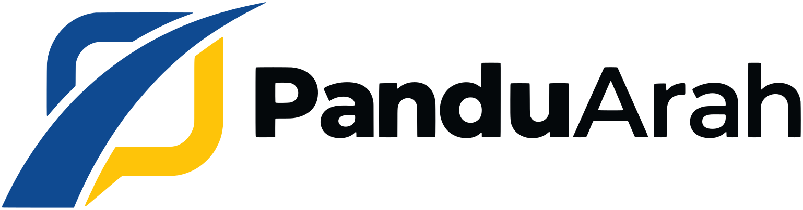
</p>

<h3 align="center">Tersesat di dalam gedung? Pindai kodenya, lalu ikuti petanya.</h3>

<p align="center">
  Peta dan navigasi dalam gedung yang berjalan langsung di browser ponsel.<br>
  <b>Tanpa beacon. Tanpa aplikasi yang harus diunduh. Tetap jalan tanpa internet.</b>
</p>

<p align="center">
  <a href="https://github.com/devaldicaliesta/indoor-map-v2/actions/workflows/ci.yml"></a>
  <a href="https://github.com/devaldicaliesta/indoor-map-v2/actions/workflows/codeql.yml"></a>
  <a href="LICENSE"></a>
  <a href="CONTRIBUTING.md"></a>
  <a href="https://yapp.ink/ImDev"></a>
  <br>
  
  
  
  
</p>

<p align="center">
  <a href="https://app.panduarah.my.id/v/demo"><b>🌐 Coba demo</b></a> ·
  <a href="https://youtu.be/pSLm7RZvioE"><b>🎬 Tonton video</b></a> ·
  <a href="#-memulai">🚀 Memulai</a> ·
  <a href="CONTRIBUTING.md">🤝 Berkontribusi</a> ·
  <a href="#english">🇬🇧 English</a>
</p>

<p align="center">
  <a href="https://app.panduarah.my.id/v/demo"></a>
  <br><sub>👆 Klik animasinya untuk mencoba rute yang sama di demo langsung</sub>
</p>

> **Edisi open source: landing page + demo.** Repo ini berisi landing page PanduArah dan tujuh gedung demo fiktif yang bisa dijalankan tanpa database, server, atau kunci apa pun. Editor peta, panel pengelola, dan backend adalah bagian dari [versi lengkap](#-versi-lengkap) dan tidak disertakan di sini.

---

## 🧭 Pilih jalurmu

Baca README ini sesuai peranmu. Klik salah satu:

| Kamu adalah… | Mulai dari sini |
| :---: | --- |
| 🚶 **Pengunjung yang penasaran** | [🎮 Misi 60 detik](#-misi-60-detik) lalu [🏢 coba demo per jenis gedung](#-untuk-gedung-apa-saja) |
| 🏢 **Pengelola gedung** | [✨ Fitur](#-fitur), [💡 Kenapa PanduArah](#-kenapa-panduarah), [🧰 Versi lengkap](#-versi-lengkap), dan [❓ Pertanyaan umum](#-pertanyaan-umum) |
| 👩‍💻 **Developer** | [🚀 Memulai](#-memulai), [🤖 Cara saya memakai AI](#-cara-saya-memakai-ai), dan [🤝 Berkontribusi](#-berkontribusi) |
| 🕵️ **Pemburu bug keamanan** | [🔐 Keamanan](#-keamanan) (laporkan secara privat, ya!) |

## 📍 Apa itu PanduArah?

**PanduArah** (dari kata *pandu*, "menuntun", dan *arah*) adalah platform **peta dan navigasi dalam gedung** (*indoor map & indoor navigation*). Pengunjung mencari tujuan lalu diantar langkah demi langkah, termasuk naik-turun lantai lewat lift, eskalator, atau tangga.

### Masalah yang diselesaikan

Titik biru di peta ponsel menghilang tepat di pintu masuk, karena GPS tidak bekerja di dalam gedung. Akibatnya:

- 🏥 pasien terlambat ke poli di rumah sakit yang luas,
- 🎓 mahasiswa baru dan tamu berputar-putar di kampus,
- ✈️ penumpang berlari mencari gerbang di terminal,
- 🙋 petugas meja depan menjawab "di mana ya…?" sepanjang hari.

Solusi navigasi dalam gedung yang umum biasanya butuh **beacon Bluetooth** (perangkat keras yang harus dibeli, dipasang, dan diganti baterainya) dan **aplikasi native** yang harus diunduh pengunjung. Biayanya sudah besar sebelum satu pengunjung pun terbantu.

### Cara PanduArah menjawabnya

PanduArah tidak menebak posisi dengan sinyal. Posisi awal pengunjung diambil dari **kode QR yang ditempel di titik yang sudah diketahui** (lobi, lift, parkir), atau dari **pilihan manual**. Hasilnya, tidak ada perangkat keras yang perlu dipasang dan tidak ada aplikasi yang perlu diunduh.

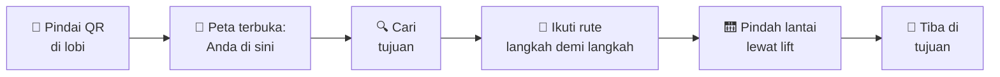

### 🩺 Sebelum dan sesudah PanduArah

Bayangkan **Bu Sari**, pertama kali datang ke rumah sakit dan harus ke Radiologi di lantai 1:

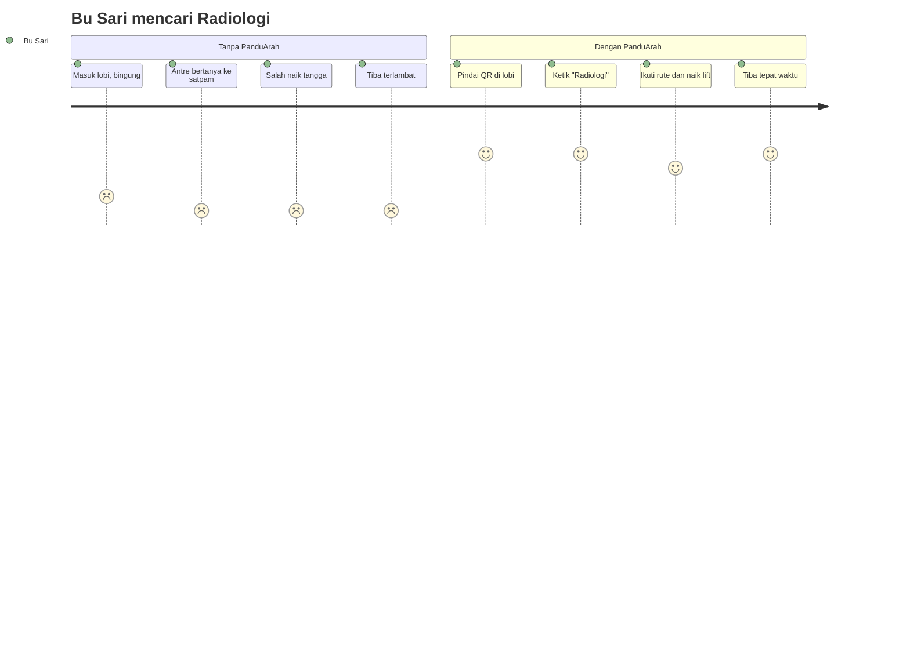

<sub>Angka 1–5 menunjukkan seberapa lega perasaan Bu Sari di tiap langkah.</sub>

## 🎮 Misi 60 detik

Buka [demo rumah sakit](https://app.panduarah.my.id/v/demo) (atau `http://localhost:5174/v/demo` setelah [`pnpm dev`](#-memulai)) dan selesaikan misi berikut. Berapa yang bisa kamu centang?

- [ ] 🔍 Ketik **"Radiologi"** di kotak pencarian
- [ ] 🧭 Ketuk **Rute ke sini**, lalu pilih **Pendaftaran** sebagai titik awal
- [ ] 🛗 Ikuti langkahnya sampai peta ikut **berpindah lantai**
- [ ] ♿ Centang **Rute aksesibel (kursi roda)** dan lihat jalurnya berubah
- [ ] 🇬🇧 Ganti bahasa ke **EN**
- [ ] 🔗 Ketuk **Bagikan** dan kirim rutenya ke temanmu

<details>
<summary>🏆 <b>Misi bonus</b> (klik kalau sudah selesai semua)</summary>

<br>

Ganti alamat `/v/demo` menjadi `/v/demo-bandara`, lalu cari rute dari **konter check-in** ke **gerbang** di lantai lain. Masih kurang? Coba matikan internet setelah peta terbuka, lalu cari rute lagi. Petanya tetap jalan. 😉

</details>

## 🏢 Untuk gedung apa saja?

PanduArah dirancang netral untuk semua jenis gedung. Ketujuh demo di bawah memakai **data fiktif**, bisa langsung dibuka tanpa login, dan semuanya ada di repo ini (`packages/demo`):

| Jenis gedung | Contoh kebutuhan | Demo |
| --- | --- | --- |
| 🏥 Rumah sakit | Pendaftaran → poli → radiologi → apotek | [`/v/demo`](https://app.panduarah.my.id/v/demo) |
| 🛍️ Pusat perbelanjaan | Cari toko per kategori, antar lantai | [`/v/demo-mal`](https://app.panduarah.my.id/v/demo-mal) |
| 🎓 Kampus | Kelas, laboratorium, perpustakaan lintas gedung | [`/v/demo-kampus`](https://app.panduarah.my.id/v/demo-kampus) |
| 🏬 Perkantoran | Ruang rapat, divisi, resepsionis | [`/v/demo-kantor`](https://app.panduarah.my.id/v/demo-kantor) |
| ✈️ Bandara | Check-in → keamanan → gerbang | [`/v/demo-bandara`](https://app.panduarah.my.id/v/demo-bandara) |
| 🏭 Pabrik | Lini produksi, gudang, jalur evakuasi | [`/v/demo-pabrik`](https://app.panduarah.my.id/v/demo-pabrik) |
| 🏟️ Stadion / konser | Tribun, pintu masuk, fasilitas | [`/v/demo-konser`](https://app.panduarah.my.id/v/demo-konser) |

> ℹ️ Demo langsung di `app.panduarah.my.id` dan videonya berjalan di **versi lengkap**. Beberapa fitur di sana, seperti tampilan 3D dan mode kios Info Point, **tidak termasuk** di edisi ini.

## ✨ Fitur

Yang bisa dicoba di repo ini:

- 🏠 **Landing page** dua bahasa yang menjelaskan cara kerja PanduArah dan membuka ketujuh demo.
- 📱 **Demo pengunjung** yang dibuka dari **tautan atau kode QR**, tanpa instalasi, dan bisa ditambahkan ke layar utama (PWA).
- 🔍 **Pencarian yang memaafkan salah ketik**, kategori berwarna, dan direktori A-Z.
- 🧭 **Rute lintas lantai dan lintas gedung** dengan petunjuk teks yang jelas: "Jalan lurus 20 m", "Naik lift ke L1".
- ♿ **Rute aksesibel** untuk kursi roda (menghindari tangga dan eskalator).
- 🚧 **Contoh penutupan sementara** (renovasi, lift diservis): rute otomatis memutar.
- 🌏 Dua bahasa (**Indonesia / Inggris**), dan **tetap jalan tanpa internet** setelah dibuka sekali.
- 🔗 **Bagikan** lokasi atau rute lewat tautan.

## 📸 Tampilan

<table>
  <tr>
    <td align="center">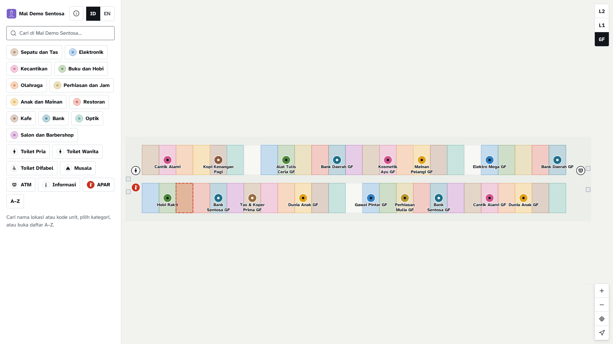<br><sub>Kategori lokasi di mal</sub></td>
    <td align="center">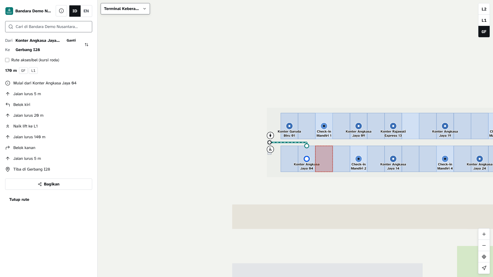<br><sub>Rute di bandara: dari check-in ke gerbang</sub></td>
  </tr>
  <tr>
    <td align="center">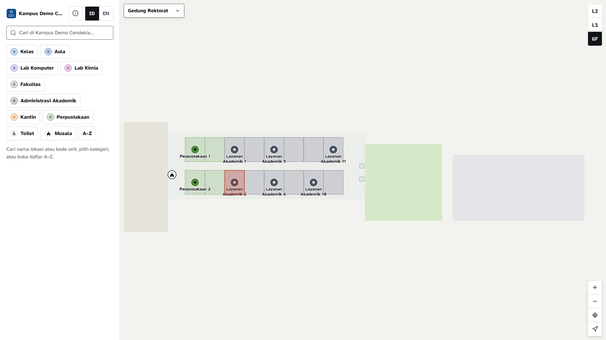<br><sub>Kampus dengan banyak gedung</sub></td>
    <td align="center">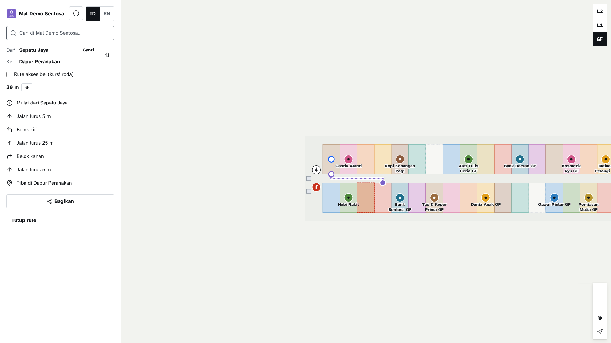<br><sub>Rute antar lantai di mal</sub></td>
  </tr>
  <tr>
    <td align="center">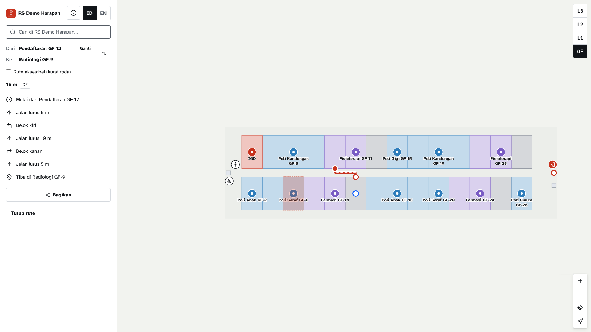<br><sub>Rute di rumah sakit: dari pendaftaran ke Radiologi</sub></td>
    <td align="center">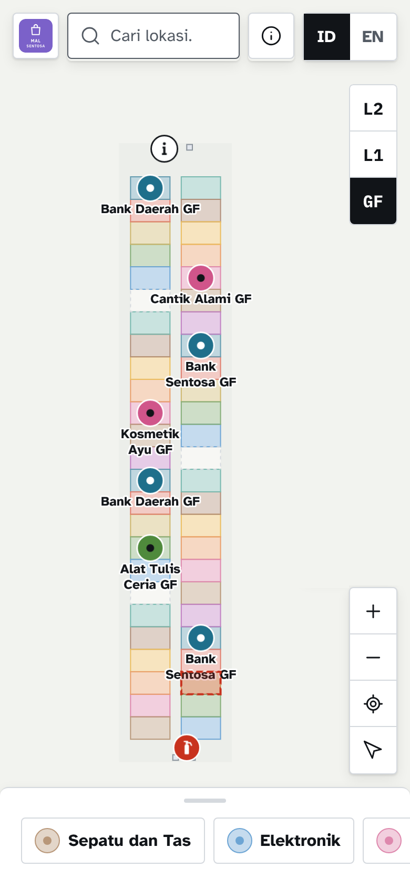&nbsp;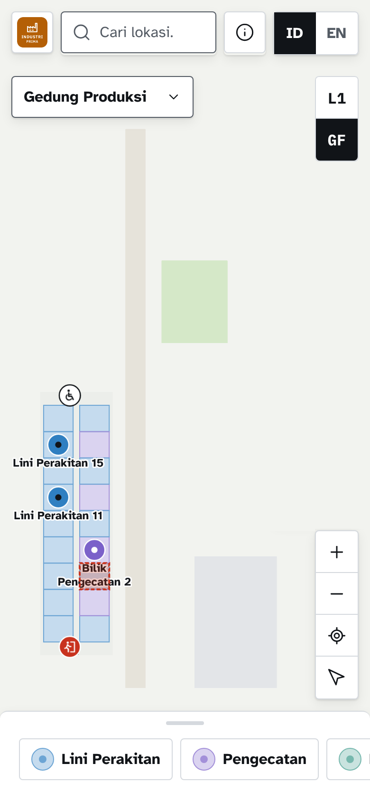<br><sub>Tampilan ponsel</sub></td>
  </tr>
</table>

## 💡 Kenapa PanduArah?

| | |
| --- | --- |
| 💸 **Tanpa perangkat keras** | Cukup kode QR yang dicetak. Tidak ada beacon yang harus dibeli, dipasang, atau diganti baterainya |
| 📲 **Tanpa unduh aplikasi** | Pengunjung cukup memindai QR; peta terbuka di browser |
| 📶 **Tetap jalan tanpa internet** | Peta dan pencarian rute dihitung di ponsel, cocok untuk basement dan area bersinyal lemah |
| ♿ **Aksesibel** | Rute khusus kursi roda, dan antarmuka diuji tanpa pelanggaran aksesibilitas (WCAG A/AA) |
| 🌏 **Dua bahasa** | Indonesia dan Inggris, termasuk teks petunjuk arah |
| 🙈 **Tanpa login dan pelacakan** | Pengunjung tidak perlu akun; tautan bagikan hanya berisi ID lokasi |
| 📦 **Format terbuka** | Peta disimpan sebagai GeoJSON, tidak terkunci pada satu vendor |

### 📊 Hasil ukur

Angka berikut dibuktikan ulang oleh test di repo ini pada setiap pull request:

| Pengujian | Hasil |
| --- | --- |
| Rute terjauh di graf 20.000 edge (`packages/routing`) | **< 50 ms** |
| Setiap lokasi di ketujuh gedung demo bisa dirutekan (`packages/demo`) | **100%** |
| Pemeriksaan aksesibilitas (axe, WCAG A/AA) di landing page dan demo | **0 pelanggaran** |
| Perangkat tanpa WebGL | **Pencarian dan rute tetap jalan** |

## 🧰 Versi lengkap

Untuk memetakan gedungmu sendiri, PanduArah versi lengkap menambahkan editor peta di browser, panel pengelola dengan beberapa role, penutupan sementara yang dikelola langsung, dan publish berversi. Versi itu **bukan** bagian dari repo open source ini.

Tertarik? Hubungi [panduarahid@gmail.com](mailto:panduarahid@gmail.com) atau kunjungi [panduarah.my.id](https://panduarah.my.id).

## 🚀 Memulai

**Prasyarat:** [Node.js 22](https://nodejs.org/) (lihat `.nvmrc`) dan **pnpm 10** (`corepack enable`). Tidak perlu Docker, database, atau kunci apa pun.

```bash
git clone https://github.com/devaldicaliesta/indoor-map-v2.git
cd indoor-map-v2
corepack enable
pnpm install

pnpm dev                      # http://localhost:5174
```

- Landing page ada di `http://localhost:5174/`, demo rumah sakit di `http://localhost:5174/v/demo`.
- Data demo dibangun langsung di browser dari `packages/demo`, jadi tidak ada yang perlu di-seed.

> 🏗️ **Mau memasang landing page dan demo ini di internet?** Ikuti panduan [Deploy landing page dan demo](docs/deploy-sendiri.md). Hasil build berupa situs statis, jadi bisa dipasang gratis di Cloudflare Pages, Netlify, atau Vercel.

<details>
<summary><b>Perintah yang sering dipakai</b></summary>

| Perintah | Fungsi |
| --- | --- |
| `pnpm dev` | Menjalankan landing page dan demo |
| `pnpm check` | Typecheck + lint + test unit. **Wajib hijau sebelum PR** |
| `pnpm build` | Build situs statis ke `apps/visitor/dist` |
| `pnpm test:e2e` | Test end-to-end di browser (Playwright) |
| `pnpm lint` | Memeriksa kode dengan Biome |
| `pnpm format` | Merapikan format kode |

</details>

<details>
<summary><b>Teknologi yang dipakai</b></summary>

| Bagian | Teknologi |
| --- | --- |
| Bahasa | TypeScript (strict) |
| Antarmuka | React 19, Vite, Tailwind CSS, shadcn/ui, i18next |
| Peta | MapLibre GL JS |
| Offline | PWA (Workbox) |
| Kualitas | Vitest, Playwright, axe, Biome, CodeQL |
| Monorepo | pnpm workspace, Turborepo |

</details>

<details>
<summary><b>Struktur folder singkat</b></summary>

```
apps/visitor/   landing page dan demo pengunjung
packages/       kode bersama (domain, routing, map-core, demo, ui)
e2e/            test end-to-end
scripts/        pembuat aset merek dan logo demo
tools/          pembuat pemberitahuan lisensi pihak ketiga
```

Setiap paket di `packages/` punya README singkat tentang tanggung jawabnya.

</details>

## 🤖 Cara saya memakai AI

Proyek ini dibangun oleh satu orang dengan bantuan **[Claude Code](https://claude.com/claude-code)** sebagai asisten pemrograman. AI tidak dibiarkan menulis sebebasnya: ia bekerja di dalam pagar yang sama dengan manusia, dan setiap hasilnya tetap saya tinjau. Berikut caranya, supaya Anda bisa memakai pola yang sama saat berkontribusi.

**1. Pecah pekerjaan menjadi task kecil yang bisa dibuktikan.** Sebelum meminta AI menulis kode, saya menulis task bernomor (`T-xxx`) berisi konteks singkat, langkah, file yang boleh disentuh, **kriteria selesai** yang bisa dibuktikan (test, perilaku yang terlihat, angka), dan batas yang tidak boleh dilanggar. Ukurannya dijaga agar selesai dalam satu sesi dan menghasilkan PR di bawah ±400 baris.

**2. Beri AI aturan proyek yang tertulis.** Claude Code membaca berkas instruksi proyek di setiap sesi. Isinya pada dasarnya sama dengan [CONTRIBUTING.md](CONTRIBUTING.md): komponen tidak membangun data sendiri, logika bisnis ada di paket bersama dan wajib disertai test, dan tidak menambah dependency tanpa alasan. Aturan itu juga memuat kapan AI harus **berhenti dan bertanya** alih-alih menebak.

**3. Ikuti alur yang sama untuk setiap task:**

```
rencana  →  kerjakan  →  test dulu untuk logika  →  verifikasi  →  tinjau  →  PR
```

1. **Rencana.** AI menyusun rencana (file, urutan, risiko); saya menyetujui atau mengoreksi sebelum ada kode.
2. **Kerjakan.** Satu task saja, di branch sendiri, dengan commit kecil.
3. **Test lebih dulu** untuk logika domain dan routing: test gagal dulu, lalu implementasi minimal sampai hijau.
4. **Verifikasi.** `pnpm check` harus hijau; test E2E ikut dijalankan untuk alur penting.
5. **Tinjau.** Peninjau kode dan peninjau keamanan berbasis AI memeriksa perubahannya, lalu saya membacanya sendiri.
6. **PR** berisi apa yang berubah, bukti kriteria selesai, dan keputusan baru bila ada.

Prinsip yang saya pegang: **perubahan terkecil yang tuntas.** Pakai ulang yang sudah ada, jangan menambah abstraksi yang tidak diminta, tetapi jangan pernah memangkas validasi, keamanan, atau aksesibilitas.

<details>
<summary><b>Tips memakai AI saat berkontribusi</b></summary>

Anda boleh memakai Claude Code, Copilot, Cursor, atau asisten lain.

- Mulai sesi dengan meminta AI membaca [CONTRIBUTING.md](CONTRIBUTING.md) dan README paket yang akan disentuh (`packages/*/README.md`).
- Minta rencana dulu, baru kode. Contoh prompt:

  > Baca CONTRIBUTING.md dan packages/routing/README.md. Saya ingin [deskripsi singkat]. Susun rencana: file yang diubah, test yang ditambah, dan risikonya. Jangan menulis kode sebelum saya setuju.

- Batasi lingkupnya ke satu issue atau satu perubahan.
- Jalankan `pnpm check` sendiri dan **baca setiap baris** yang akan Anda kirim. Anda yang bertanggung jawab atas PR Anda, bukan AI-nya.
- Jangan pernah menempelkan isi `.env.local`, token, atau data pribadi ke dalam prompt.
- Sebutkan di deskripsi PR bila sebagian besar kode dibuat dengan bantuan AI.

</details>

## 🗺️ Roadmap

| Tahap | Fokus |
| --- | --- |
| **Sekarang** | Uji performa di perangkat nyata, perbaikan terjemahan, dan demo gedung tambahan |
| **Berikutnya** | Petunjuk berbasis patokan ("lewati apotek") dan estimasi waktu jalan, fasilitas terdekat, rute ke beberapa tujuan, peta cetak "Anda di sini" |
| **Nanti** | Bahasa daerah dan bahasa lain di antarmuka pengunjung |

Punya ide atau kebutuhan lain? [Buka issue](https://github.com/devaldicaliesta/indoor-map-v2/issues) dan ceritakan kasusnya.

## 🧠 Tebak-tebakan

Uji seberapa kenal kamu dengan PanduArah. Tebak dulu, baru klik jawabannya!

<details>
<summary><b>1. Berapa beacon Bluetooth yang harus dipasang di gedung?</b></summary>

<br>**Nol.** 🎯 Posisi awal diambil dari kode QR yang dicetak atau pilihan manual.
</details>

<details>
<summary><b>2. Rute dihitung di server atau di ponsel?</b></summary>

<br>**Di ponsel.** 📱 Karena itu server tetap ringan saat pengunjung ramai, dan rute tetap bisa dicari tanpa internet.
</details>

<details>
<summary><b>3. Lift sedang diperbaiki. Apa yang terjadi pada rute pengunjung?</b></summary>

<br>**Rute otomatis memutar.** 🔀 Rute mencari jalan lain, misalnya lift lain atau eskalator. Demo rumah sakit punya contohnya: satu lift sedang diservis dan satu ruangan sedang direnovasi.
</details>

<details>
<summary><b>4. Berapa lama rute terjauh dihitung di graf dengan 20.000 edge?</b></summary>

<br>**Kurang dari 50 milidetik.** ⚡ Lebih cepat dari kedipan mata, dan dibuktikan ulang oleh test di setiap pull request.
</details>

<details>
<summary><b>5. Apa arti nama "PanduArah"?</b></summary>

<br>**Menuntun arah.** 🧭 *Pandu* artinya menuntun atau memandu, *arah* ya arah. Itu memang satu-satunya tugasnya: mengantar kamu sampai tujuan.
</details>

## ❓ Pertanyaan umum

<details>
<summary><b>Bagaimana aplikasi tahu posisi saya tanpa GPS?</b></summary>

Dari kode QR yang ditempel di titik yang sudah diketahui (misalnya lobi atau depan lift). Saat Anda memindainya, aplikasi tahu Anda berada di titik itu. Anda juga bisa memilih titik awal secara manual.
</details>

<details>
<summary><b>Apakah pengunjung harus memasang aplikasi?</b></summary>

Tidak. Peta terbuka di browser ponsel. Bila ingin, pengunjung bisa menambahkannya ke layar utama seperti aplikasi biasa.
</details>

<details>
<summary><b>Apakah bisa dipakai tanpa internet?</b></summary>

Bisa. Setelah peta dibuka sekali, peta, pencarian, dan perhitungan rute tetap jalan tanpa koneksi.
</details>

<details>
<summary><b>Apakah PanduArah mengumpulkan data pengunjung?</b></summary>

Tidak. Pengunjung tidak perlu login, dan tautan yang dibagikan hanya berisi ID lokasi dan pilihan tampilan, bukan data pribadi.
</details>

<details>
<summary><b>Bagaimana cara memetakan gedung saya sendiri?</b></summary>

Lewat [versi lengkap](#-versi-lengkap) PanduArah, yang menyediakan editor peta dan panel pengelola. Repo ini hanya berisi landing page dan demo.
</details>

<details>
<summary><b>Bolehkah saya memakai kode ini?</b></summary>

Boleh. Proyek ini berlisensi [MIT](LICENSE), jadi Anda bebas memakai, mengubah, dan memasang landing page dan demonya, selama pemberitahuan hak cipta tetap disertakan. Panduannya ada di [Deploy landing page dan demo](docs/deploy-sendiri.md).
</details>

## 🤝 Berkontribusi

Kontribusi sangat diterima, dari perbaikan typo, terjemahan, dan test sampai demo gedung baru. Semua pull request diarahkan ke branch **`develop`**; `main` hanya berisi versi stabil.

1. Baca [CONTRIBUTING.md](CONTRIBUTING.md) untuk cara menyiapkan lingkungan, aturan kode, dan alur PR.
2. Cari issue berlabel `good first issue` bila ini kontribusi pertama Anda.
3. Ikuti [Kode Etik](CODE_OF_CONDUCT.md) agar komunitas tetap nyaman untuk semua.

Setiap PR otomatis diperiksa (test, build, pemindaian keamanan) sebelum ditinjau.

## 🔐 Keamanan

Menemukan celah keamanan? **Jangan** buka issue publik. Laporkan secara privat lewat tab **Security → Report a vulnerability**, atau ikuti [SECURITY.md](SECURITY.md).

## 📄 Lisensi

[MIT](LICENSE) © 2026 Devaldi Caliesta. Pemberitahuan lisensi pihak ketiga dibuat otomatis saat build (`apps/visitor/dist/third-party-notices.txt`) dan ditautkan dari footer landing page.

## ☕ Dukung pengembangnya

PanduArah dikembangkan oleh satu orang di waktu luang. Kalau proyek ini membantu kamu atau gedungmu, kamu bisa ikut menyemangati pengembangnya dengan **traktir kopi** 😄

<p align="center">
  <a href="https://yapp.ink/ImDev"></a>
</p>

Tidak bisa traktir? Tidak apa-apa. Beri ⭐, bagikan ke teman, laporkan bug, atau kirim PR. Semua itu dukungan yang sama berharganya. 🙏

## 👤 Pembuat

Dibuat oleh **[Devaldi Caliesta](https://github.com/devaldicaliesta)**.

- 🌐 Situs produk: [panduarah.my.id](https://panduarah.my.id)
- ✉️ Email: [panduarahid@gmail.com](mailto:panduarahid@gmail.com)
- ☕ Traktir kopi: [yapp.ink/ImDev](https://yapp.ink/ImDev)

<p align="center">
  <b>Kalau proyek ini bermanfaat, beri ⭐ supaya lebih banyak orang tidak tersesat lagi.</b><br>
  <sub>Dibuat dengan ☕ dan banyak sekali denah gedung di Indonesia 🇮🇩</sub>
</p>

---

## English

**PanduArah** (Indonesian for roughly "guide the way") is an **indoor map and indoor navigation** product for hospitals, campuses, offices, airports, factories, malls, and stadiums. Visitors search for a destination and get step-by-step directions across floors and buildings.

**This repository is the open-source landing page + demo edition.** It contains the marketing landing page and seven fictional demo venues that run entirely in the browser: no database, backend, or keys required. The map editor, management panel, and backend belong to the full version and are not included here; contact [panduarahid@gmail.com](mailto:panduarahid@gmail.com) if you need them.

- **No beacons, no app install.** Visitors locate themselves by scanning a QR code at a known point, or by picking a starting point manually. The map opens in the phone's browser.
- **Works offline.** Search and route calculation run on the phone; the map keeps working after it has been opened once.
- **Accessible and bilingual.** Wheelchair-friendly routes and an Indonesian/English interface.

**Try it:** [live demo](https://app.panduarah.my.id/v/demo) (fictional hospital) · [demo video](https://youtu.be/pSLm7RZvioE). The live demo and video run the full version; some features there (3D view, Info Point kiosk mode) are not part of this edition.

**Get started:** Node 22 and pnpm 10, then `pnpm install && pnpm dev` and open `http://localhost:5174`. **Deploy:** the build is a static site in `apps/visitor/dist` ([guide](docs/deploy-sendiri.md), Indonesian). **Contributing:** [CONTRIBUTING.md](CONTRIBUTING.md) (PRs go to `develop`) · **Security:** [SECURITY.md](SECURITY.md) · **License:** [MIT](LICENSE)

**How AI was used:** the project was built with Claude Code working inside written project rules, on small numbered tasks with provable acceptance criteria, tests first for core logic, `pnpm check` as a hard gate, and AI-assisted plus human review before every PR. Contributors are welcome to use AI tools under the same rules.

The UI and most docs are in Indonesian; issues and PRs in English are welcome.

Enjoying PanduArah? ☕ [Buy the developer a coffee](https://yapp.ink/ImDev).
